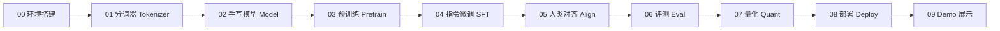

# llama31-8b-scratch

> 从零一行行手写，构建一个可在工业中实际落地的 **Llama 3.1 8B** 全流程项目：分词 → 预训练 → 指令微调 → 人类对齐 → 评测 → 量化 → 部署 → Demo。

`llama31-8b-scratch` 是一套**双层工程**：核心原理（模型结构、注意力、RoPE、RMSNorm、训练循环、PPO/DPO/ORPO/GRPO 的数学逻辑）全部用**纯 Python + PyTorch 手写**并配无跳步中文注释；规模化训练与高吞吐推理则封装 DeepSpeed、FSDP、PEFT、TRL、vLLM、SGLang 等成熟工业框架，并在文档里讲清原理与 tradeoff。

## 为什么有这个项目

- **看得懂成型过程**：目录按搭建顺序编号（`00 → 09`），每个编号目录都有一篇"本期解决什么问题 / 核心原理 / 关键代码 / 运行命令 / 常见坑"的讲解文档，适合逐期录制成系列知识点视频。
- **真机可跑**：默认提供 CPU 小样本 smoke 配置，分钟级跑通整条链路；8B 全量训练/推理配置可直接搬到 GPU 云（如单卡 5090、多卡 A100/H100）。
- **覆盖经典与前沿**：既包含 Transformer 训练的全套经典技术，也纳入 2024–2026 的 GQA、FlashAttention-2、QLoRA、Liger Kernel、ORPO、GRPO、AWQ、SGLang 等新经典技术。

## 全链路总览



| 阶段 | 手写教学实现 | 工业级封装 |
|---|---|---|
| 分词 | BPE 训练、词表合并与扩充 | `tokenizers` / SentencePiece / tiktoken |
| 模型 | RMSNorm、RoPE、GQA、SwiGLU、KV Cache | 与 HF Llama 权重逐字兼容 |
| 预训练 | 手写训练循环、优化器、调度器 | DeepSpeed ZeRO、FSDP、FlashAttention-2、Liger Kernel |
| 微调 | 损失掩码、序列打包 | LoRA / QLoRA、TRL SFTTrainer |
| 对齐 | RM、PPO、DPO、ORPO、GRPO 手写数学 | TRL 全套 Trainer |
| 评测 | 困惑度、多选 loglikelihood | lm-eval-harness |
| 量化 | 手写对称/仿射量化数学 | GPTQ、AWQ、bitsandbytes、GGUF |
| 部署 | FastAPI OpenAI 兼容服务 | vLLM、SGLang、Docker |
| Demo | Gradio 网页对话 | OpenAI 客户端调用 |

## 快速开始

### 1. 环境准备

要求 Python ≥ 3.10、PyTorch ≥ 2.2。

```bash
git clone <your-fork>/llama31-8b-scratch.git
cd llama31-8b-scratch

# 最小核心依赖（手写链路 + CPU smoke）
pip install -e .

# 完整依赖（训练/量化/部署，按需安装可选组）
pip install -e ".[model,train,quant,deploy,eval]"
```

环境与安装排查见 [`00_setup/README.md`](00_setup/README.md)。

### 2. 一键冒烟测试（CPU，无需 GPU）

```bash
make smoke
# 等价于
bash scripts/smoke_test.sh
```

该脚本用 `configs/model/smoke.yaml` 的极小模型，依次走通：分词 → 模型前向/保存加载 → 若干预训练步 → SFT 步 → DPO 步，全部在 CPU 完成。

### 3. 单元测试与静态检查

```bash
make test       # unittest 全量，CPU 可跑
make compile    # 全部 Python 文件 py_compile
make bashcheck  # 全部 shell 脚本 bash -n
```

## 目录结构

```
llama31-8b-scratch/
├── configs/                 # 全部 YAML/JSON 配置（模型、训练、对齐、量化、部署）
│   ├── model/               # llama3.1_8b.yaml（真机）、smoke.yaml（CPU）
│   ├── tokenizer/  pretrain/  sft/  align/  eval/  quant/  deploy/
├── src/llama31_8b_scratch/           # 可 import 的核心包（实质实现都在这里）
│   ├── common/              # 配置、日志、种子、路径（基础设施）
│   ├── model/               # 手写 Transformer 解码器
│   ├── generation/          # KV Cache、采样、generate 解码
│   ├── data/                # 分词、数据处理、数据集、collator
│   ├── training/            # 预训练/微调训练循环与分布式封装
│   ├── align/               # RM/PPO/DPO/ORPO/GRPO
│   ├── evaluation/          # 困惑度、多选、lm-eval 封装
│   ├── quantization/        # 手写量化数学与 GPTQ/AWQ/bnb/GGUF
│   └── deployment/          # OpenAI 兼容 API、vLLM/SGLang、客户端
├── 00_setup/ … 09_demo/     # 编号目录：阶段讲解文档 + 薄入口脚本
├── scripts/                 # 统一 _env.sh 与启动脚本
├── tests/core/              # CPU 单元测试（unittest）
├── data/toy/                # 冒烟用小样本 jsonl
├── docs/                    # 架构图、视频路线图
├── Dockerfile  docker-compose.yml
└── requirements.txt  pyproject.toml  LICENSE
```

## 分阶段教程（按顺序学/录）

| 期 | 目录 | 这一期你能讲清 |
|---|---|---|
| 00 | [00_setup](00_setup/README.md) | 环境、依赖、CUDA、可复现性 |
| 01 | [01_tokenizer](01_tokenizer/README.md) | BPE 原理、训练分词器、词表扩充与 embedding 扩展 |
| 02 | [02_model](02_model/README.md) | RMSNorm、RoPE、GQA、SwiGLU、KV Cache，从张量到完整模型 |
| 03 | [03_pretrain](03_pretrain/README.md) | 训练循环、优化器/调度器、bf16、ZeRO/FSDP、FlashAttention |
| 04 | [04_sft](04_sft/README.md) | 对话模板、损失掩码、LoRA/QLoRA、序列打包 |
| 05 | [05_align](05_align/README.md) | 奖励模型、PPO、DPO、ORPO、GRPO 的数学与取舍 |
| 06 | [06_eval](06_eval/README.md) | 困惑度、loglikelihood 评测、lm-eval-harness |
| 07 | [07_quant](07_quant/README.md) | 量化数学、GPTQ/AWQ/NF4/GGUF |
| 08 | [08_deploy](08_deploy/README.md) | OpenAI 兼容 API、vLLM/SGLang、Docker |
| 09 | [09_demo](09_demo/README.md) | Gradio 网页对话、OpenAI 客户端调用 |

## 模型配置

`llama31-8b-scratch` 默认对齐 **Llama 3.1 8B** 基座，结构数值与官方一致（见 `configs/model/llama3.1_8b.yaml`）：

| 超参 | 值 | 说明 |
|---|---|---|
| 隐藏维度 hidden_size | 4096 | |
| 层数 num_hidden_layers | 32 | |
| 注意力头 / KV 头 | 32 / 8 | **GQA**，每 4 个 Q 头共享 1 组 KV |
| 头维度 head_dim | 128 | |
| FFN 中间维度 | 14336 | SwiGLU |
| 词表 vocab_size | 128256 | Llama 3 tokenizer |
| 最大上下文 | 131072 | 原生 128K |
| RoPE 基频 | 500000 | 配合长上下文 |
| 归一化 | RMSNorm，eps 1e-5 | |

由于手写模型的 `state_dict` 键名与 HF Llama 逐字一致，训练产出可直接被 transformers、vLLM、SGLang 以 `model_type="llama"` 加载，无需注册任何自定义模型。

## 技术清单

**经典全流程**：BPE 分词与词表扩展、RMSNorm、RoPE、MHA/GQA、SwiGLU、KV Cache、SDPA、梯度检查点、AdamW、cosine warmup、fp16/bf16 混合精度、奖励模型、PPO 经典 RLHF、DPO、GPTQ、llama.cpp/GGUF、vLLM、网页 Demo。

**2024–2026 增补**：FlashAttention-2（文档兼讲 FlashAttention-3）、Liger Kernel、LoRA/QLoRA(NF4)、FSDP 与 DeepSpeed ZeRO 3、`torch.compile`、序列打包、RoPE 长上下文缩放（linear/NTK/YaRN）、**ORPO**、**GRPO**、AWQ、bitsandbytes 8bit/4bit、SGLang、OpenAI 兼容流式 API、Docker、lm-eval-harness、wandb/tensorboard 可观测。

## 视频录制路线图

完整的分集规划、知识点拆分与每期代码锚点见 [`docs/roadmap.md`](docs/roadmap.md)；架构与模块依赖见 [`docs/architecture.md`](docs/architecture.md)。

## 许可证

本项目基于 [Apache License 2.0](LICENSE) 发布。Llama 3.1 模型与词表的使用须同时遵守 Meta 官方许可协议。

