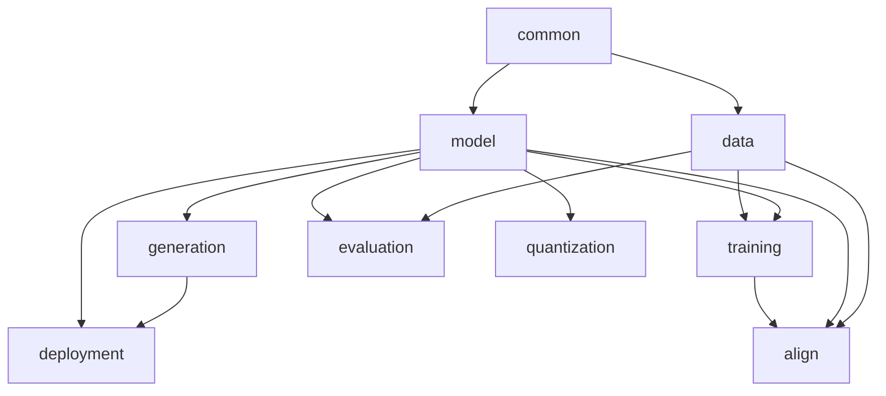

# 架构设计

## 1. 总体分层

`llama31-8b-scratch` 自上而下分为四层：

```
┌──────────────────────────────────────────────────────────┐
│  入口层  00_setup … 09_demo（薄 CLI + 讲解文档）           │
├──────────────────────────────────────────────────────────┤
│  编排层  training / align / evaluation / deployment        │
│          （训练循环、对齐算法、评测、服务的流程编排）         │
├──────────────────────────────────────────────────────────┤
│  核心层  model / generation / data                        │
│          （手写模型、解码、分词、数据集——纯 PyTorch）        │
├──────────────────────────────────────────────────────────┤
│  基础层  common（配置/日志/种子/路径）+ 可选工业框架         │
└──────────────────────────────────────────────────────────┘
```

依赖方向只能从上往下，核心层不依赖编排层；同层模块通过 `SPEC.md` 冻结的接口通信，避免循环导入。

## 2. 为什么采用「手写核心 + 工业封装」双层

- **教学目标**要求把底层原理讲透：注意力怎么算、RoPE 为什么能编码相对位置、DPO 的梯度从哪里来。这些只有手写、配无跳步注释才能在视频里逐行讲清。
- **工业目标**要求 8B 模型真的能训、能高并发服务：单卡显存放不下 8B 全量，需要 ZeRO/FSDP 切分；手写注意力吞吐远不及 FlashAttention；线上服务需要 PagedAttention 级别的吞吐。这些直接复用成熟框架最稳妥。
- 二者通过**统一权重格式**衔接：手写模型严格使用 HF Llama 的 `state_dict` 键名并输出标准 `config.json`，因此同一份权重既能被手写代码加载做教学，也能被 vLLM/SGLang 直接服务，无需转换。

## 3. 模块依赖关系



- `data` 与 `model` 是两块基石：前者定义对话模板与数据 schema，后者定义网络结构与权重命名。
- `align` 复用 `model` 的 backbone 与 `data` 的偏好数据，但在算法内部自带 logp 收集、优势估计等独立逻辑。
- `deployment` 只依赖模型的生成接口与 schema，不感知训练过程。

## 4. 配置体系

- 所有超参进 YAML，入口脚本只负责 `--config` 与 `--override`。
- 配置支持 `_base_` 继承与深度合并：例如 smoke 与 8B 配置共享同一份字段结构，只覆盖尺寸与硬件相关项。
- 配置加载器（`llama31_8b_scratch.common.config`）仅依赖 PyYAML，可在无 GPU 环境单测。

## 5. 数据契约

| 用途 | 文件 | 字段 |
|---|---|---|
| 预训练 | `*.jsonl` | `text` |
| SFT | `*.jsonl` | `messages[]` |
| 偏好对齐 | `*.jsonl` | `prompt / chosen / rejected` |
| GRPO | `*.jsonl` | `prompt[] / answer` |

## 6. 可演进点

- 在 `model/` 下可平行扩展 MoE（路由 + 专家）实现，接口与稠密模型保持一致。
- 部署层后端可插拔：`service.py` 抽象了统一 generate 接口，新增推理后端只需实现该接口。
- 评测任务通过 YAML 声明式扩展，新增 benchmark 不需要改评测代码。
